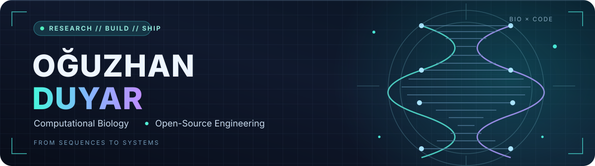
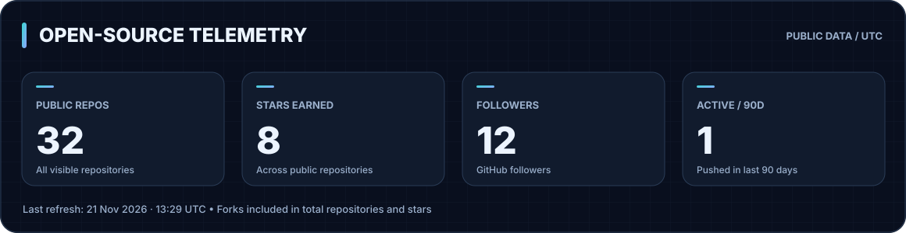
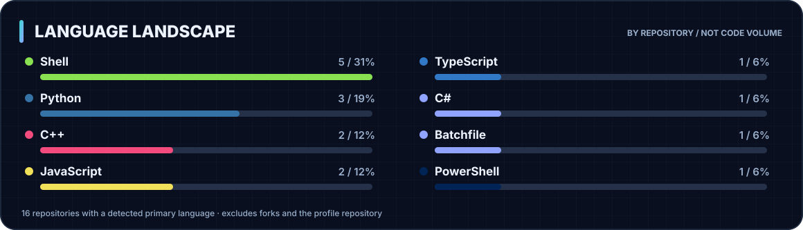
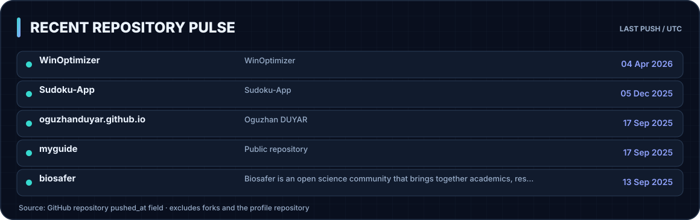

  

  
  
  

  <a href="https://oguzhanduyar.github.io/">Portfolio</a> &nbsp;·&nbsp;
  <a href="https://biosafer.org/">Biosafer</a> &nbsp;·&nbsp;
  <a href="https://github.com/OguzhanDUYAR?tab=repositories">Repositories</a> &nbsp;·&nbsp;
  <a href="https://github.com/OguzhanDUYAR?tab=overview">Contribution activity</a>

### Hello, I'm Oğuzhan.

I'm a biologist working at the intersection of **microbial ecology, bioinformatics, and software engineering**. I enjoy turning research questions into reproducible workflows, building practical Linux tools, and experimenting with web and game development.

My work moves between two connected questions: **What can we learn from complex biological data?** And **how can we build better tools to work with it?**

<table>
<tr>
<td width="50%" valign="top">

<strong>01 / COMPUTATIONAL BIOLOGY</strong>

Metagenomics · Microbial ecology · Sequencing data quality control · Statistical analysis · Reproducible research

<code>Samples → Sequences → QC → Analysis → Interpretation</code>

</td>
<td width="50%" valign="top">

<strong>02 / SOFTWARE &amp; SYSTEMS</strong>

Linux · Automation · Web engineering · Game development · Performance and tooling

<code>Design → Build → Test → Optimize → Release</code>

</td>
</tr>
</table>

### Live engineering telemetry

<picture>
  <source media="(prefers-color-scheme: dark)" srcset="./assets/telemetry-dark.svg" />
  <source media="(prefers-color-scheme: light)" srcset="./assets/telemetry-light.svg" />
  
</picture>

Generated from public GitHub API records once daily via GitHub Actions. “Active / 90d” counts non-fork repositories with a push in that interval, not the number of commits. Values may lag between scheduled runs.

### Code landscape

<picture>
  <source media="(prefers-color-scheme: dark)" srcset="./assets/languages-dark.svg" />
  <source media="(prefers-color-scheme: light)" srcset="./assets/languages-light.svg" />
  
</picture>

Counts reflect each repository's primary language, not my proficiency, time spent coding, or source code volume. Repositories without a detected language are excluded.

### GitHub contribution snapshot

<picture>
  <source media="(prefers-color-scheme: dark)" srcset="./assets/stats-dark.svg" />
  <source media="(prefers-color-scheme: light)" srcset="./assets/stats-light.svg" />
  
</picture>

### Latest public repository updates

<picture>
  <source media="(prefers-color-scheme: dark)" srcset="./assets/activity-dark.svg" />
  <source media="(prefers-color-scheme: light)" srcset="./assets/activity-light.svg" />
  
</picture>

### Selected open-source work

<table>
<tr>
<td width="50%" valign="top">

<strong><a href="https://github.com/OguzhanDUYAR/biosafer">Biosafer</a></strong>

An open-science initiative focused on genetic resources, accessible datasets, and research collaboration.

</td>
<td width="50%" valign="top">

<strong><a href="https://github.com/OguzhanDUYAR/Soda-Icon-Theme">Soda Icon Theme</a></strong>

A personal icon-theme project exploring visual design and desktop customization.

</td>
</tr>
<tr>
<td width="50%" valign="top">

<strong><a href="https://github.com/OguzhanDUYAR/akis-e-imza">AKİS E-İmza</a></strong>

Linux and Debian installation tooling for AKİS electronic signatures, including Java compatibility work.

</td>
<td width="50%" valign="top">

<strong><a href="https://github.com/OguzhanDUYAR/wallpapers">Wallpapers</a></strong>

A collection of wallpapers I designed.

</td>
</tr>
</table>

<a href="https://github.com/OguzhanDUYAR?tab=repositories"><strong>Explore all public repositories →</strong></a>

### Technical toolkit

*Tools and technologies I use, study, or build around. This is not a proficiency ranking.*

  
  
  
  
  
  
  
  
  
  

### Contribution trail

<picture>
  <source media="(prefers-color-scheme: dark)" srcset="./assets/snake-dark.svg" />
  <source media="(prefers-color-scheme: light)" srcset="./assets/snake-light.svg" />
  
</picture>

---

  <strong>Science-driven questions. Engineering-minded solutions.</strong>
  
Open to thoughtful exchanges about bioinformatics, reproducibility, Linux, and open-source tools.

  <a href="https://biosafer.org/">Website</a> · <a href="https://github.com/OguzhanDUYAR">GitHub</a> · <a href="https://oguzhanduyar.github.io/">Personal page</a>
   
  Visual metrics refresh automatically. Individual projects retain their own licensing terms.

